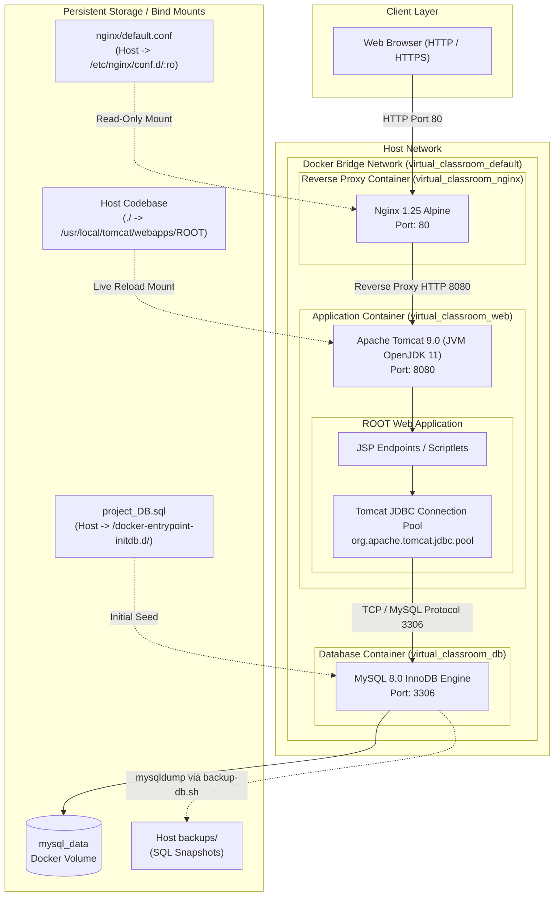
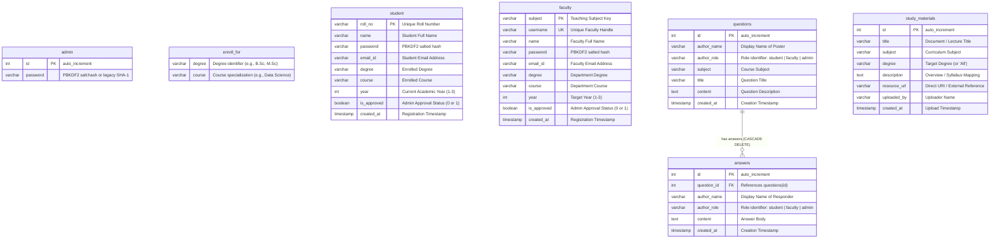
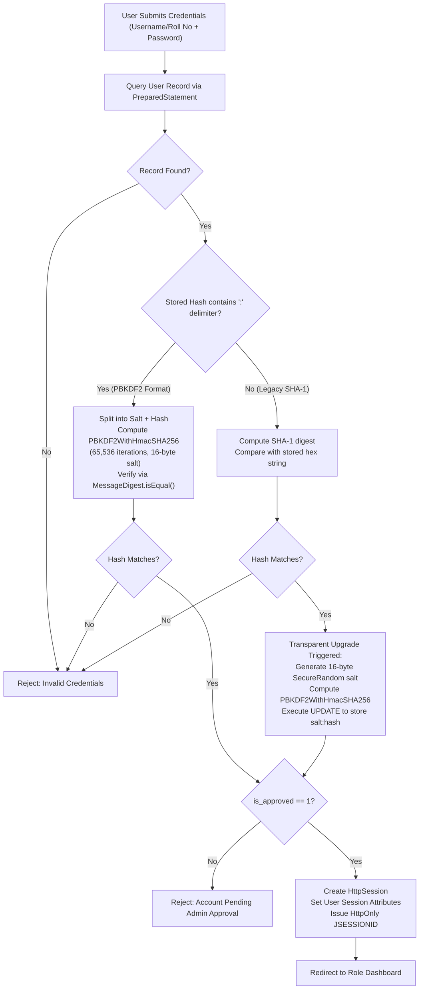
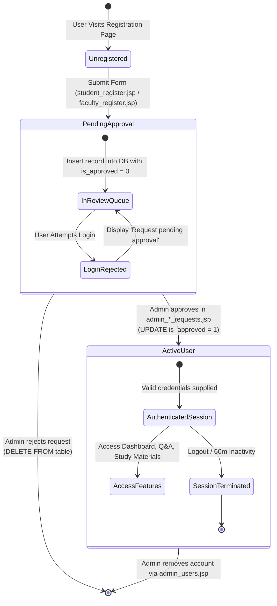

# Virtual Classroom — System Architecture & Production Deployment Guide

A multi academic management portal and learning management system (LMS) built on JavaServer Pages (JSP), Apache Tomcat 9, MySQL 8.0, and an Nginx reverse proxy edge gateway.

The application implements role-based access control (RBAC) across Students, Faculty, and System Administrators, backed by connection-pooled database interactions, transparent cryptographic password migration, and containerized deployment.


## 1. System Architecture

### 1.1 Infrastructure Topology

The deployment comprises three isolated containerized tiers interconnected via a private Docker bridge network (`virtual_classroom_default`). Only the Nginx edge gateway and development ports are exposed to the host machine.




## . Database Schema & Data Models

### 3.1 Entity-Relationship Diagram (ERD)

The database `project` consists of 7 normalized tables managing identity, curriculum boundaries, collaborative learning, and educational assets:




## . Security Architecture

###  Password Hashing & Transparent Migration

Passwords are processed through a cryptographic layer in `db.jspf`. To maintain backwards compatibility with legacy SHA-1 database hashes without compromising security, the system employs **transparent on-login re-hashing**:



#### Cryptographic Parameters
- **Algorithm**: `PBKDF2WithHmacSHA256`
- **Key Length**: 128 bits
- **Iteration Count**: 65,536 iterations
- **Salt Generation**: 16 bytes via `java.security.SecureRandom`
- **Timing Attack Mitigation**: Uses `MessageDigest.isEqual()` for constant-time byte comparisons.
- **Storage Format**: `Base64(salt) + ":" + Base64(hash)` (fits within `VARCHAR(255)`).

### 4.2 Session Management

Session configuration is enforced at the container level in `WEB-INF/web.xml`:

```xml
<session-config>
    <session-timeout>60</session-timeout>
    <cookie-config>
        <http-only>true</http-only>
        <name>JSESSIONID</name>
    </cookie-config>
    <tracking-mode>COOKIE</tracking-mode>
</session-config>
```

- **`http-only=true`**: Eliminates client-side JavaScript access to `JSESSIONID`, mitigating session hijacking via XSS.
- **`tracking-mode=COOKIE`**: Disables URL rewriting (e.g., `;jsessionid=...`), avoiding session leakage in HTTP referrers and server access logs.
- **Session Expiry**: 60-minute inactivity threshold.


### HTTP Security Headers

Nginx injects baseline security headers on every outbound HTTP response:

```nginx
add_header X-Frame-Options "SAMEORIGIN" always;
add_header X-XSS-Protection "1; mode=block" always;
add_header X-Content-Type-Options "nosniff" always;
add_header Referrer-Policy "strict-origin-when-cross-origin" always;
```

---

## 5. Role-Based Access Control (RBAC) & Lifecycle

### 5.1 User Registration & Approval State Machine

Students and Faculty cannot access the platform immediately upon registration. All accounts pass through an administrative approval workflow before credentials become active:



### 5.2 Role Matrix

| Capability / Resource | Guest / Public | Student | Faculty | Admin |
| :--- | :---: | :---: | :---: | :---: |
| View Landing Page & Course Catalogs (`index.jsp`) | Yes | Yes | Yes | Yes |
| Submit Account Registration | Yes | No | No | No |
| Access Student Dashboard (`student_dashboard.jsp`) | No | Yes | No | No |
| Access Faculty Dashboard (`faculty_dashboard.jsp`) | No | No | Yes | No |
| Access Admin Dashboard (`admin_dashboard.jsp`) | No | No | No | Yes |
| Browse & Download Study Materials (`study-material.jsp`) | No | Yes | Yes | Yes |
| Publish New Study Materials (`study-material.jsp`) | No | No | Yes | Yes |
| Post Q&A Discussion Questions (`qna.jsp`) | No | Yes | Yes | Yes |
| Submit Answers to Discussion Questions (`qna.jsp`) | No | Yes | Yes | Yes |
| Approve / Reject Student Requests (`admin_student_requests.jsp`)| No | No | No | Yes |
| Approve / Reject Faculty Requests (`admin_faculty_requests.jsp`)| No | No | No | Yes |
| Revoke / Delete User Accounts (`admin_users.jsp`) | No | No | No | Yes |

---

## 6. Configuration & Environment Variables

All runtime credentials and port bindings are decoupled into `.env` (derived from `.env.example`). The stack loads these parameters into the Docker Compose orchestration context:

| Variable | Default Value | Scope | Description |
| :--- | :--- | :--- | :--- |
| `MYSQL_ROOT_PASSWORD` | `Mypasswordis2425` | `db`, backup scripts | Administrative password for MySQL `root` user. |
| `MYSQL_DATABASE` | `project` | `db` | Default database instantiated on first initialization. |
| `MYSQL_USER` | `vclass_user` | `db`, `web` | Restricted application database username. |
| `MYSQL_PASSWORD` | `VClassSecret2026!` | `db`, `web` | Password assigned to `MYSQL_USER`. |
| `DB_HOST` | `db` | `web` | Hostname of the database container within Docker bridge network. |
| `DB_PORT` | `3306` | `web` | MySQL service listening port inside the network. |
| `DB_NAME` | `project` | `web` | Target database catalog name. |
| `DB_USER` | `vclass_user` | `web` | Username consumed by Tomcat JDBC connection pool. |
| `DB_PASSWORD` | `VClassSecret2026!` | `web` | Database password consumed by Tomcat connection pool. |
| `WEB_PORT` | `8080` | Host -> `web` | Host port mapped directly to Tomcat for development inspection. |
| `HTTP_PORT` | `80` | Host -> `nginx` | Host port mapped to Nginx reverse proxy (primary entrypoint). |

---

## 7. Operational Runbook

### 7.1 Prerequisites

- **Docker Engine**: Version 20.10.0+
- **Docker Compose**: Version 2.0.0+ (Compose V2)
- **Bash Shell**: For executing `./start.sh`, `./stop.sh`, and `./backup-db.sh`.
- **Curl**: Required by `start.sh` to poll application health.

### 7.2 Starting the Cluster

To build and start the entire multi-container environment:

```bash
./start.sh
```

Alternatively, run Docker Compose directly:

```bash
docker compose up -d --build
```

The startup script initiates containers in order of health dependencies:
1. `virtual_classroom_db`: Starts MySQL 8.0 and evaluates internal healthcheck (`mysqladmin ping`) every 3 seconds.
2. `virtual_classroom_web`: Waits until `db` reaches a healthy state before starting Tomcat and mounting the web application.
3. `virtual_classroom_nginx`: Starts after `web` is running and begins routing traffic on port 80.

Verify running containers:

```bash
docker compose ps
```

Expected status:
```text
NAME                     IMAGE                      STATUS                   PORTS
virtual_classroom_db     mysql:8.0                  Up (healthy)             0.0.0.0:3306->3306/tcp
virtual_classroom_web    virtual-classroom-web      Up                       0.0.0.0:8080->8080/tcp
virtual_classroom_nginx  nginx:alpine               Up                       0.0.0.0:80->80/tcp
```

### 7.3 Stopping the Cluster

To stop containers gracefully while preserving database volumes:

```bash
./stop.sh
```

Or via Compose:

```bash
docker compose down
```

> [!WARNING]
> To wipe all persistent database records and reset to baseline seed data, run:
> ```bash
> docker compose down -v
> ```

### 7.4 Database Backups & Point-in-Time Recovery

#### Creating an Immediate Snapshot
Run the automated backup utility:

```bash
./backup-db.sh
```

The script extracts the `MYSQL_ROOT_PASSWORD` from `.env` (or defaults) and executes a non-blocking `mysqldump` stream directly out of the container:

```bash
docker exec virtual_classroom_db mysqldump -u root -p"$ROOT_PASS" project > backups/project_backup_<TIMESTAMP>.sql
```

Snapshots are written to the host `backups/` directory with UNIX timestamps.

#### Restoring from a Snapshot
To restore the database from an existing `.sql` snapshot file:

```bash
docker exec -i virtual_classroom_db mysql -u root -p"$MYSQL_ROOT_PASSWORD" project < backups/project_backup_YYYYMMDD_HHMMSS.sql
```

### 7.5 Default Bootstrap Credentials

Initial seed records configured in `project_DB.sql`:

| Role | Username / Identifier | Password | Access URL |
| :--- | :--- | :--- | :--- |
| **Administrator** | N/A (Master Key) | `admin123` *(or `Mypasswordis2425`)* | `http://localhost/admin_login.jsp` |
| **Faculty (Teacher)** | `teacher` | `teacher123` | `http://localhost/faculty_login.jsp` |
| **Student** | Roll No: `2001` | `student123` | `http://localhost/student_login.jsp` |

---

## 8. Repository Structure

```text
Virtual-Classroom/
├── Dockerfile                          # Multi-stage/Slim Tomcat 9 OpenJDK 11 container definition
├── docker-compose.yml                  # 3-tier service topology (Nginx, Tomcat, MySQL)
├── nginx/
│   └── default.conf                    # Nginx reverse proxy configuration & security headers
├── project_DB.sql                      # DDL schema definition & initial seed datasets
├── db.jspf                             # Centralized JDBC connection pool, PBKDF2 hashing, XSS escaper
├── WEB-INF/
│   └── web.xml                         # Deployment descriptor (HttpOnly sessions, welcome file)
├── start.sh                            # Cluster bootstrap & health check polling script
├── stop.sh                             # Graceful container shutdown script
├── backup-db.sh                        # Automated mysqldump backup utility
├── backups/                            # Local persistent storage directory for SQL dumps
├── .env.example                        # Blueprint for environment variables
├── .env                                # Local secrets & host configuration (Git-ignored)
│
├── index.jsp                           # Public landing page with course listings
├── quick_login_box.jspf                # Reusable navigation login modal
│
├── student_register.jsp                # Student onboarding form (inserts with is_approved=0)
├── student_login.jsp                   # Student authentication handler & session initializer
├── student_dashboard.jsp               # Student home portal
├── student_logout.jsp                  # Student session invalidation
│
├── faculty_register.jsp                # Faculty onboarding form (inserts with is_approved=0)
├── faculty_login.jsp                   # Faculty authentication handler & session initializer
├── faculty_dashboard.jsp               # Faculty home portal
├── faculty_logout.jsp                  # Faculty session invalidation
│
├── admin_login.jsp                     # Administrator authentication handler
├── admin_dashboard.jsp                 # Administrator control center
├── admin_student_requests.jsp          # Student registration review queue
├── admin_student_requests_action.jsp   # Student approval / rejection transaction handler
├── admin_faculty_requests.jsp          # Faculty registration review queue
├── admin_faculty_requests_action.jsp   # Faculty approval / rejection transaction handler
├── admin_users.jsp                     # User directory & active account deletion hub
├── admin_logout.jsp                    # Administrator session invalidation
│
├── qna.jsp                             # Interactive question and answer forum
└── study-material.jsp                  # Subject-wise educational resource distribution hub
```

---
